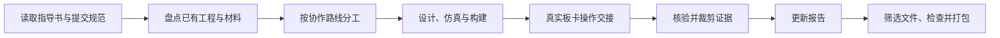

# Digital Logic Lab Skill

面向数字逻辑与 FPGA 课程实验的 Codex Skill。它把实验指导书、已有工程、仿真、板卡验证、报告和提交包串成一条可续做的流程，并通过三种协作路线控制自动化程度。

## 能做什么

- 从实验指导书、报告模板和提交规范中提取实验项目、模块名、测试组合、器件、证据及命名要求。
- 盘点并复用已有的 Logisim、Verilog、Testbench、XDC、bitstream、截图和报告内容。
- 在工具可用时完成工程创建或修复、仿真、综合、实现、bit 生成和软件截图。
- 把真实板卡操作整理为明确的拨码、按键、预期现象与拍照清单。
- 核验和裁剪用户提供的截图或实拍照片，只保留能够证明实验结果的有效区域。
- 更新实验报告，区分理论预期、软件实测和用户确认的硬件结果。
- 根据课程规则筛选文件，并用附带脚本检查、生成最终 ZIP。

## 三种协作路线

| 路线 | 适用场景 | 助手负责 | 用户负责 |
| --- | --- | --- | --- |
| 路线一：全流程代办（默认） | 希望尽量自动完成 | 软件侧全流程、验证、报告、打包 | 真实板卡操作与拍照 |
| 路线二：逐步教学 | 希望边做边学 | 每次给一个小步骤、纠错、美化、报告 | 按步骤操作并回传结果 |
| 路线三：协作搭建 | 希望保留原创设计工作 | 建工程、录入手册已有代码、最小修正、后续验证与报告 | 画逻辑图，编写手册未提供的代码 |

用户未指定时采用路线一。可随时用自然语言切换，例如：“改成路线二”“一步步教我”“只搭好环境，我自己画图写代码”。

## 工作流



技能会在实验工作目录维护 `lab-state.json`，记录当前路线、项目状态、证据和交付物。仿真通过、bit 生成、bit 下载和实物验证被视为不同里程碑，不会互相替代。

## 安装

将本仓库复制到 Codex skills 目录，并保持目录名为 `digital-logic-lab`：

```text
~/.codex/skills/digital-logic-lab/
```

重新启动或刷新 Codex 后，在任务中引用 `$digital-logic-lab`，并提供实验指导书、提交规范、报告模板或已有工程路径。

## 使用示例

默认全流程：

```text
$digital-logic-lab 读取这份实验指导书，按默认路线完成能自动完成的部分，并告诉我真实板卡上要怎么操作。
```

逐步教学：

```text
$digital-logic-lab 改成路线二，从创建 Vivado 工程开始一步步教我，每步确认后再继续。
```

协作搭建：

```text
$digital-logic-lab 使用路线三，把软件、工程、文件和手册已给代码准备好，逻辑图和未给出的代码由我完成。
```

## 打包脚本

- `scripts/package_submission.py`：依据清单生成实验 ZIP，并检查缺失、重复和不应提交的文件。
- `scripts/check_packaging.py`：检查已有压缩包的文件名和内容结构。

具体参数以脚本的 `--help` 为准。提交规则必须来自当前课程材料，不能把示例课程中的文件数量或命名当作通用标准。

## 仓库结构

```text
digital-logic-lab/
├── SKILL.md
├── agents/
│   └── openai.yaml
├── references/
│   ├── automation-modes.md
│   ├── evidence-report.md
│   ├── submission.md
│   ├── tongji-example.md
│   └── workflow.md
└── scripts/
    ├── check_packaging.py
    └── package_submission.py
```

`references/tongji-example.md` 只是一个课程规则实例，用于展示如何把具体提交要求映射到通用流程，不代表其他课程也要求相同数量或命名。

## 隐私与安全边界

- 仓库不包含学生姓名、学号、邮箱、实验报告、板卡照片、本机绝对路径、登录信息或课程提交凭据。
- `lab-state.json`、实验截图、照片、报告、bit 文件和构建目录属于本地实验材料，不应提交到本仓库。
- 技能不会伪造仿真或实物结果，也不会把“生成 bit”写成“已经下板验证”。
- 除非用户明确要求，技能不会上传课程作业或消耗提交次数。

## 验证

可使用 Codex 自带的 skill 校验器检查结构与元数据：

```text
python <skill-creator>/scripts/quick_validate.py /path/to/digital-logic-lab
```

两个 Python 脚本仅使用标准库，不需要额外安装依赖。
